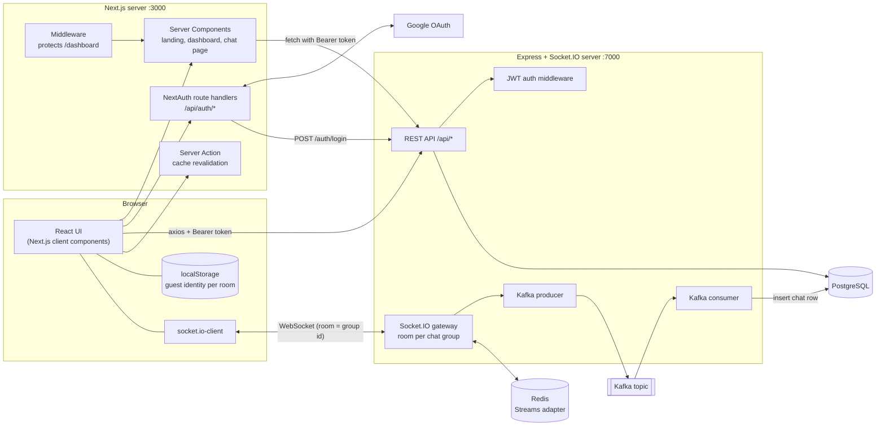
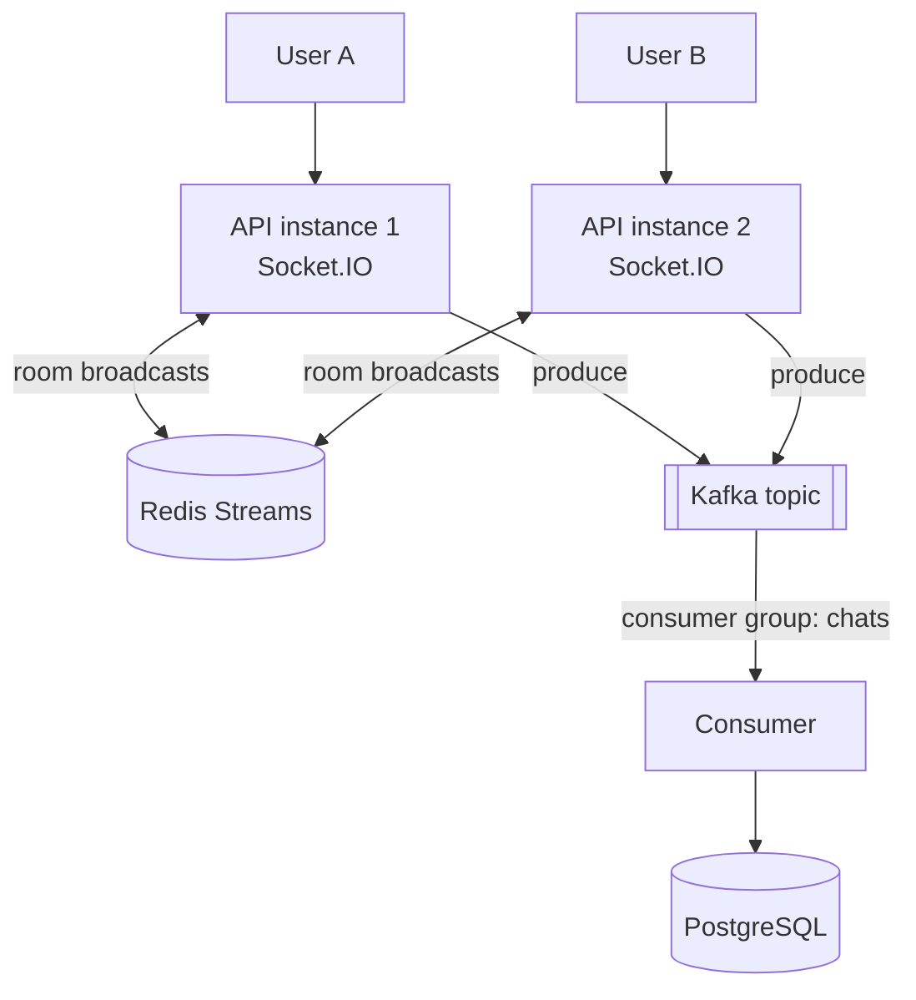
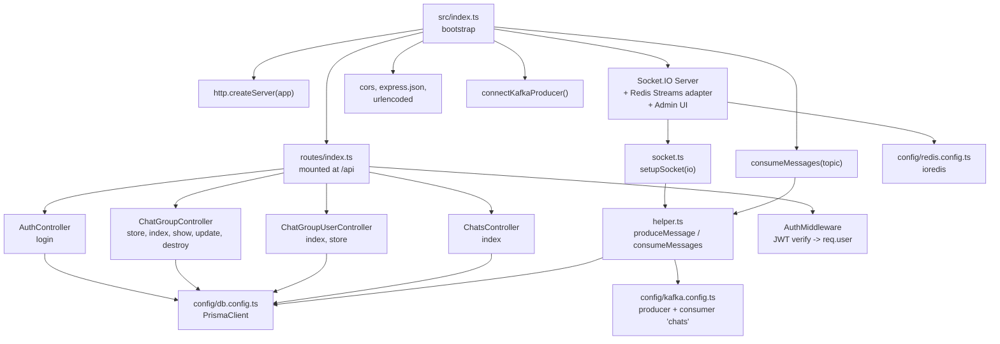
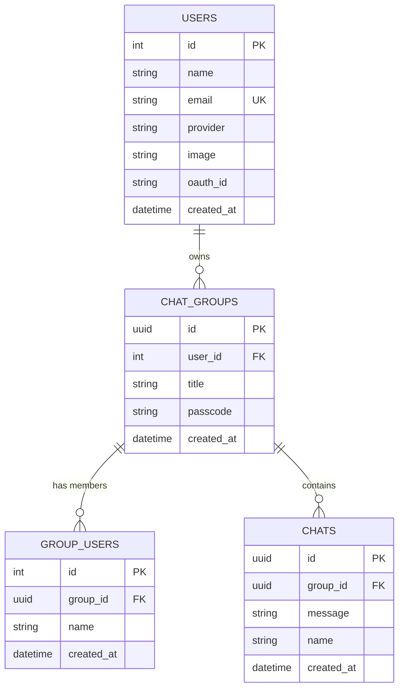
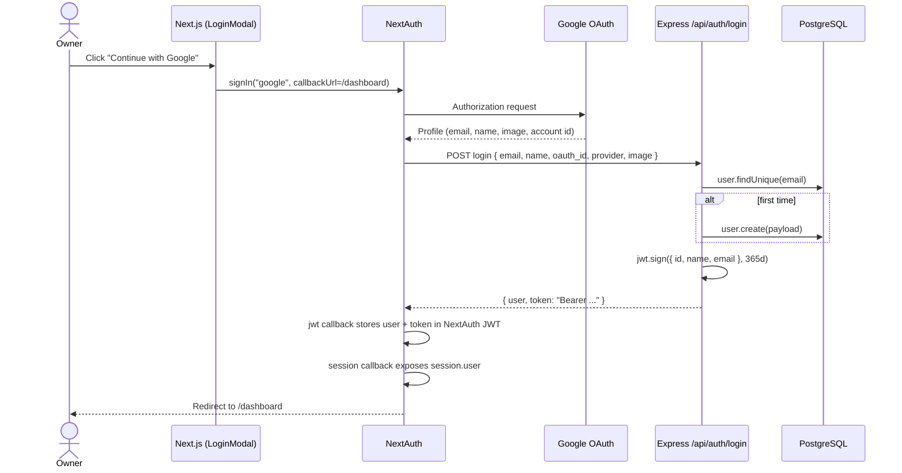
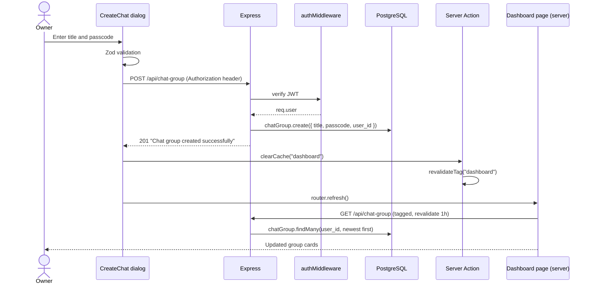
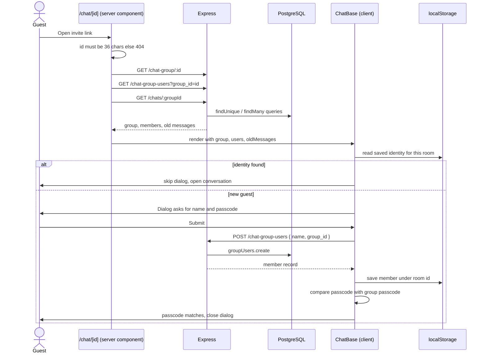
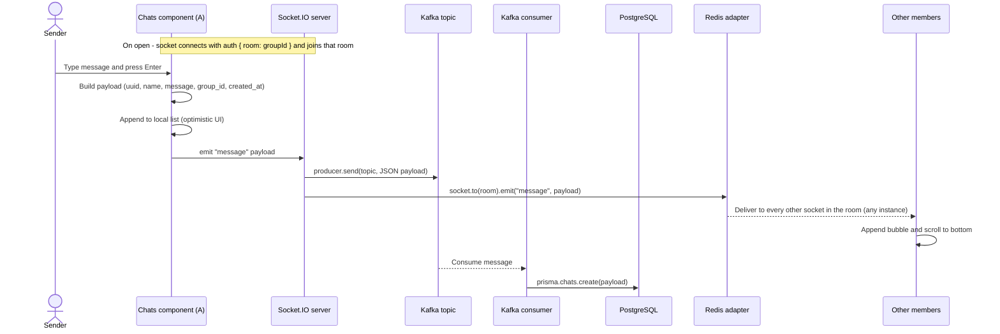
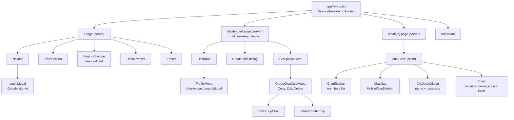

# QuickChat - Real-Time Group Chat Rooms

QuickChat lets a signed-in user create a **passcode-protected chat room** and share its link. Anyone with the link can join with just a display name - no account needed - and chat in **real time**. Messages are delivered instantly over WebSockets and persisted **asynchronously through Kafka** into PostgreSQL, with **Redis** keeping Socket.IO servers in sync so the backend can scale horizontally.


---

## Table of Contents

1. [Features](#features)
2. [Tech Stack](#tech-stack)
3. [High-Level Design (HLD)](#high-level-design-hld)
4. [Low-Level Design (LLD)](#low-level-design-lld)
5. [API Reference](#api-reference)
6. [Socket.IO Events](#socketio-events)
7. [Project Structure](#project-structure)
8. [Getting Started](#getting-started)
9. [Environment Variables](#environment-variables)
10. [Scripts](#scripts)
11. [Design Decisions](#design-decisions)

---

## Features

### 1. Authentication (Room Owners)
- **Sign in with Google** through NextAuth.js (OAuth 2.0).
- On first login the backend **creates the user record**; on later logins it simply finds it (matched by email).
- The backend issues a **JWT** (1-year expiry) that NextAuth keeps inside the user session, so every authenticated API call carries `Authorization: Bearer <token>`.
- The `/dashboard` route is protected by NextAuth middleware; logged-out visitors are sent back to the landing page.
- Profile menu with avatar (falls back to the first letter of the name) and a logout confirmation dialog.

### 2. Dashboard - Manage Chat Rooms
- **Create a group** with a title (4-191 characters) and a passcode (4-25 characters), validated with Zod + React Hook Form.
- **List all your groups**, newest first, as cards showing title, passcode and creation date.
- **Edit** a group's title and passcode from a pre-filled dialog.
- **Delete** a group after a confirmation dialog; its members and messages are removed with it (cascade delete).
- **Copy invite link** (`/chat/<group-id>`) to the clipboard in one click.
- Toast notifications for every success and error state.

### 3. Joining a Room (Guests)
- Open an invite link and a dialog asks for a **display name and the room passcode**.
- Joining registers the guest as a **group member** and remembers their identity in the browser (`localStorage`, keyed by room id), so returning to the same room skips the dialog.
- Invalid or non-existent room ids render a custom 404 page.

### 4. Real-Time Messaging
- Instant message delivery to everyone in the room over **Socket.IO** (one Socket.IO room per chat group).
- **Optimistic UI**: your own message appears immediately in the conversation.
- Chat bubbles are styled per sender: your messages on the right in blue, others on the left in grey.
- **Message history**: previous messages are loaded server-side when the room opens, then live messages are appended.
- **Members sidebar** listing everyone who has joined with their join date (a slide-out sheet on mobile).

### 5. Scalable, Durable Message Pipeline
- Every message is published to a **Kafka topic**; a Kafka **consumer** writes it to PostgreSQL, so slow database writes never block delivery.
- The **Redis Streams adapter** lets multiple Socket.IO server instances share rooms, so users connected to different instances still receive each other's messages.
- **Socket.IO Admin UI** is wired in for inspecting connections and rooms during development.

### 6. Landing Page & UX
- Marketing landing page: hero, feature cards, testimonials, navbar with a Google login modal, and footer.
- Responsive layout built with Tailwind CSS v4 and shadcn/ui components.
- Server-rendered pages with cached dashboard data that is refreshed on demand after any change.

---

## Tech Stack

| Layer | Technology |
|---|---|
| **Frontend framework** | Next.js 16 (App Router, Server Components, Server Actions), React 19, TypeScript |
| **UI** | Tailwind CSS v4, shadcn/ui (Base UI + Radix), lucide-react, Sonner (toasts), next-themes |
| **Forms & validation** | React Hook Form, Zod, `@hookform/resolvers` |
| **Auth** | NextAuth.js v4 (Google provider), `jsonwebtoken` on the API |
| **HTTP / realtime client** | Axios, `fetch` (with Next.js caching), `socket.io-client`, `uuid` |
| **Backend** | Node.js, Express 5, TypeScript (ESM), `tsx` for development |
| **Realtime** | Socket.IO 4, `@socket.io/redis-streams-adapter`, `@socket.io/admin-ui` |
| **Messaging** | Apache Kafka via KafkaJS (SASL/SCRAM-SHA-256 over TLS) |
| **Cache / pub-sub** | Redis via `ioredis` |
| **Database & ORM** | PostgreSQL, Prisma 6 (migrations included) |

---

## High-Level Design (HLD)

QuickChat is a two-service system (Next.js web app + Express API) backed by PostgreSQL, Redis and Kafka. The browser talks to the API in two ways: **REST** for room management and **WebSockets** for live chat.



### Horizontal scaling model

Because each Socket.IO server instance only knows its own sockets, the **Redis Streams adapter** relays room broadcasts between instances. Kafka consumers in the same consumer group share the topic, so each message is written to the database exactly once.



### Key architectural points
| Concern | Approach |
|---|---|
| **Two kinds of users** | *Owners* authenticate with Google and manage rooms. *Guests* need only an invite link, a display name and the passcode. |
| **Auth bridge** | NextAuth handles Google OAuth in the web app; its sign-in callback exchanges the profile for an API-issued JWT that is stored in the session. |
| **Realtime transport** | Socket.IO connection is opened with `auth: { room: <group id> }`; the server rejects connections without a room and joins the socket to that room. |
| **Write-behind persistence** | Messages are broadcast first and saved afterwards: socket handler -> Kafka -> consumer -> PostgreSQL. |
| **Scale-out** | Redis Streams adapter for cross-instance rooms; Kafka consumer group for parallel, exactly-once-per-group processing. |
| **Rendering strategy** | Server Components fetch data on the server; the dashboard list is cached for an hour under a tag and invalidated on demand after create/edit/delete. |
| **Invite links** | Chat groups use UUID primary keys, so room URLs are non-sequential and hard to guess. |

---

## Low-Level Design (LLD)

### 1. Backend module structure



### 2. Data model (PostgreSQL via Prisma)



All foreign keys use **`ON DELETE CASCADE`**: deleting a user removes their groups, and deleting a group removes its members and messages. `chat_groups` and `chats` have an index on `created_at`.

### 3. Sequence - Google login & session



### 4. Sequence - Create a group (and cache refresh)



### 5. Sequence - Opening a room and joining as a guest



### 6. Sequence - Sending a message (the core flow)



### 7. Frontend component tree



### 8. Frontend data layer

| Concern | Implementation |
|---|---|
| **API endpoints** | Centralised in `src/lib/apiEndPoints.ts`, built from `NEXT_PUBLIC_BACKEND_URL`. |
| **Server-side fetching** | `src/fetch/*` helpers used by Server Components. The dashboard list uses `revalidate: 3600` with the `dashboard` tag; chat data uses `no-cache`. |
| **Cache invalidation** | A Server Action (`clearCache`) calls `revalidateTag`, followed by `router.refresh()` on the client. |
| **Mutations** | Axios calls from client components with the session's Bearer token. |
| **Session** | NextAuth `jwt`/`session` callbacks copy the API user (id, name, image, provider, token) into `session.user`. |
| **Socket singleton** | `getSocket()` lazily creates one `socket.io-client` instance (`autoConnect: false`); the chat component sets `auth.room` and connects. |
| **Guest identity** | Member record stored in `localStorage` under the room id. |
| **Validation** | Zod schema (`createChatSchema`) shared by the create and edit forms. |

---

## API Reference

Base URL: `http://localhost:7000/api`. "Auth" means an `Authorization: Bearer <jwt>` header is required.

| Method | Endpoint | Auth | Description |
|---|---|:-:|---|
| `POST` | `/auth/login` | - | Upsert a user by email from the OAuth profile (`name, email, provider, oauth_id, image`). Returns the user plus a JWT. |
| `POST` | `/chat-group` | Yes | Create a group (`title, passcode`) owned by the authenticated user. |
| `GET` | `/chat-group` | Yes | List the authenticated user's groups, newest first. |
| `GET` | `/chat-group/:id` | - | Fetch one group by id (used when opening an invite link). |
| `PUT` | `/chat-group/:id` | Yes | Update a group's `title` and `passcode`. |
| `DELETE` | `/chat-group/:id` | Yes | Delete a group (members and messages cascade). |
| `GET` | `/chat-group-users?group_id=<uuid>` | - | List members of a group. |
| `POST` | `/chat-group-users` | - | Add a member (`name, group_id`). |
| `GET` | `/chats/:groupId` | - | Fetch stored messages for a group. |

---

## Socket.IO Events

| Direction | Event | Payload | Behaviour |
|---|---|---|---|
| Client -> Server | *(handshake)* | `auth: { room: <groupId> }` | Server middleware rejects the connection if no room is supplied, otherwise the socket joins that room. |
| Client -> Server | `message` | `{ id, group_id, name, message, created_at }` | Server publishes it to Kafka, then broadcasts to the rest of the room. |
| Server -> Client | `message` | same payload | Delivered to every other socket in the room, across all server instances. |

---

## Project Structure

```
quick_chat/
├── server/                              # Express + Socket.IO API
│   ├── prisma/
│   │   ├── schema.prisma                # User, ChatGroup, GroupUsers, Chats
│   │   └── migrations/                  # users, groups_and_users, chats
│   └── src/
│       ├── index.ts                     # bootstrap: HTTP, Socket.IO, Redis, Kafka
│       ├── socket.ts                    # room handshake + message handler
│       ├── helper.ts                    # Kafka produce / consume helpers
│       ├── config/                      # db (Prisma), kafka, redis
│       ├── controllers/                 # Auth, ChatGroup, ChatGroupUser, Chats
│       ├── middlewares/AuthMiddleware.ts
│       └── routes/index.ts
└── front/                               # Next.js app
    ├── types.ts                         # ChatGroupType, GroupChatUserType, MessageType
    └── src/
        ├── app/
        │   ├── page.tsx                 # landing page
        │   ├── dashboard/page.tsx       # owner dashboard
        │   ├── chat/[id]/page.tsx       # chat room
        │   └── api/auth/[...nextauth]/  # NextAuth config + route
        ├── components/
        │   ├── base/                    # Navbar, Hero, Features, Reviews, Footer
        │   ├── auth/                    # LoginModal, LogoutModal, ProfileMenu
        │   ├── dashboard/               # DashNav
        │   ├── groupChat/               # Create, Edit, Delete, Card, CardMenu
        │   ├── chat/                    # ChatBase, Chats, Sidebar, Nav, UserDialog
        │   ├── common/                  # UserAvatar
        │   └── ui/                      # shadcn/ui primitives
        ├── fetch/                       # server-side data fetchers
        ├── actions/common.ts            # revalidateTag server action
        ├── lib/                         # env, endpoints, socket singleton
        ├── providers/SessionProvider.tsx
        ├── validations/                 # Zod schemas
        └── middleware.ts                # protects /dashboard
```

---

## Getting Started

### Prerequisites
- Node.js 20+ and npm
- PostgreSQL database
- Redis on `localhost:6379` (for example `docker run -d --name quickchat-redis -p 6379:6379 redis`)
- A Kafka cluster that uses **SASL/SCRAM-SHA-256 over TLS**, with a topic created and its CA certificate saved as `server/certs/ca.pem`
- Google OAuth credentials (Client ID and Secret) with the redirect URI `http://localhost:3000/api/auth/callback/google`

### 1. Clone
```bash
git clone https://github.com/ShreyanshPachouri/quick_chat.git
cd quick_chat
```

### 2. Set up the API
```bash
cd server
npm install
```
Create `server/.env` (see [Environment Variables](#environment-variables)), then place the Kafka CA certificate at `server/certs/ca.pem`.

```bash
npx prisma migrate deploy      # create the tables
npx prisma generate            # generate the Prisma client
npm run dev                    # API + Socket.IO on http://localhost:7000
```

### 3. Set up the web app
```bash
cd ../front
npm install
```
Create `front/.env.local` (see below), then:
```bash
npm run dev                    # http://localhost:3000
```

### 4. Try it out
1. Open http://localhost:3000 and sign in with Google.
2. On the dashboard, click **Create Group**, set a title and passcode.
3. Use the card menu to **Copy** the invite link.
4. Open the link in another browser or an incognito window, enter a name and the passcode, and start chatting.

---

## Environment Variables

**`server/.env`**

| Variable | Description |
|---|---|
| `DATABASE_URL` | PostgreSQL connection string used by Prisma |
| `JWT_SECRET` | Secret used to sign and verify API JWTs |
| `PORT` | API port (defaults to `7000`) |
| `KAFKA_BROKER` | Kafka broker `host:port` |
| `KAFKA_USERNAME` | Kafka SASL username |
| `KAFKA_PASSWORD` | Kafka SASL password |
| `KAFKA_TOPIC` | Topic used for chat messages |

**`front/.env.local`**

| Variable | Description |
|---|---|
| `NEXT_PUBLIC_APP_URL` | Public URL of the web app, e.g. `http://localhost:3000` (used to build invite links) |
| `NEXT_PUBLIC_BACKEND_URL` | API base URL, e.g. `http://localhost:7000` (also the Socket.IO endpoint) |
| `GOOGLE_CLIENT_ID` | Google OAuth client id |
| `GOOGLE_CLIENT_SECRET` | Google OAuth client secret |
| `NEXTAUTH_URL` | Canonical URL of the web app, e.g. `http://localhost:3000` |
| `NEXTAUTH_SECRET` | Random string used by NextAuth to sign session tokens |

> `.env` files and the `certs/` folder are git-ignored - never commit secrets.

---

## Scripts

| Location | Command | What it does |
|---|---|---|
| server | `npm run dev` | Start the API with `tsx watch` (hot reload) |
| server | `npm run build` | Compile TypeScript to `dist/` |
| server | `npm start` | Run the compiled server |
| server | `npm run watch` | Compile in watch mode |
| front | `npm run dev` | Next.js dev server |
| front | `npm run build` | Production build |
| front | `npm start` | Serve the production build |
| front | `npm run lint` | ESLint |

---

## Design Decisions

- **Guests don't need accounts** - only room owners authenticate. Joining takes an invite link, a name and the passcode, which keeps the barrier to chatting as low as possible.
- **Broadcast first, persist later** - the socket handler publishes to Kafka and emits to the room without waiting on the database, so message latency doesn't depend on write speed. A consumer drains the topic into PostgreSQL.
- **Kafka as a buffer** - spikes in message volume queue up in the topic instead of overloading the database, and consumers can be scaled through the consumer group.
- **Redis Streams adapter** - makes Socket.IO stateless across instances, so the realtime tier can scale horizontally behind a load balancer.
- **One Socket.IO room per chat group** - the room id is the group UUID, so message fan-out is naturally scoped.
- **Optimistic UI** - the sender's message is rendered immediately and the server broadcasts only to the *other* sockets, avoiding duplicates.
- **NextAuth + API-issued JWT** - the web app owns the Google OAuth flow while the API stays the single source of truth for users and tokens.
- **Server Components with tagged caching** - pages render on the server; the dashboard list is cached for an hour and invalidated on demand with `revalidateTag` whenever a group changes.
- **UUID room ids** - invite links are non-sequential, so room URLs cannot be guessed by incrementing an id.
- **Cascade deletes** - deleting a group removes its members and messages in the database itself, with no cleanup code.
- **Typed end to end** - TypeScript on both services, Prisma-generated types on the server and shared shape types (`ChatGroupType`, `GroupChatUserType`, `MessageType`) on the client.

---

## Author

**Shreyansh Pachouri** - [GitHub](https://github.com/ShreyanshPachouri)
